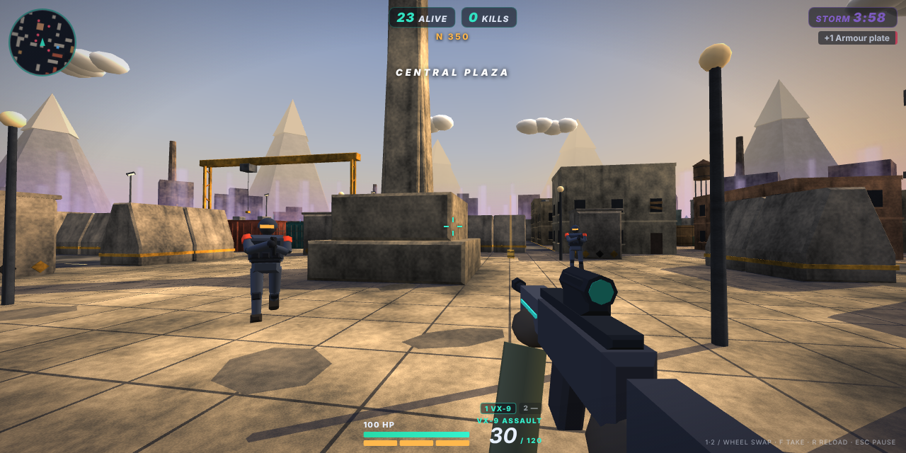

# VANTA ZONE

A landscape, last-one-standing first-person shooter that runs in a phone browser — built to play smoothly on low-end Android phones. The whole game is one HTML file plus a bundled copy of three.js r128 (`vendor/`). There are no other assets: every shape, colour, texture and sound is generated in code.

## Play
**Play now: https://tekisolves.github.io/vantazone/** (GitHub Pages, deployed from `main`). Hold the phone in landscape.

On Android, use **Add to Home screen** in the browser menu: it then opens full screen in landscape like an app, and works offline after the first visit. You can also open `index.html` from a local web server.

**Phone:** left thumb moves · right thumb turns/looks (push further = faster) · FIRE · AIM (scope) · SPRINT · RELOAD · SWAP (or TAKE a gun from a crate) · II pauses.

**Laptop:** WASD · mouse look · left click fire · right click scope · Shift sprint · R reload · 1 / 2 / wheel swap · F take a gun · Esc or P pause · Enter deploys.

**Controller (PlayStation/Xbox):** sticks move/look · R2 fire · L2 scope · L3 sprint · Square/X reload · Triangle/Y or R1 swap · Options pause · Cross/A starts from the menus.

The game detects the device and sets controls, quality and aim help to match.

**First match:** a short tutorial walks you through the controls (skip it or replay it from ⚙ Settings).

**Tune your aim:** set MODE to RANGE, play 12 targets, and follow the tip on the results screen.

## What keeps it fresh
- **A new 40x40 city every match**, in five districts (Container Yard, Old Town, The Ruins, Rail Depot, Central Plaza), each with its own cover and a landmark to navigate by. The storm closes toward a different spot each time.
- **Three guns**: VX-9 Assault, KR-12 Breacher (shotgun), LR-7 Marksman. Weapon crates (sky-blue beams) hold the ones you didn't bring.
- **Loadout**: your starting GUN plus one PERK (Plated, Lightfoot, Scavenger, Steady Hands).
- **Ranks and XP** saved on your device: 10 ranks, starting-gun unlocks, gun finishes, personal records.
- **Daily challenge** for bonus XP.

## Art direction — "stylised grit"
Clear, simplified shapes and colours (like Fortnite or Valorant), with the grit in the surfaces: one generated grime texture (rain streaks, rust, stains, cracks), half-Lambert light, a cool-shadow/warm-light grade and dust haze. Dark enemies with one hostile red-orange accent. Colour = meaning (mint = you, red-orange = enemy, violet = storm, amber = armour, green = health, sky blue = weapon crate). Hard surfaces crisp, organic shapes smooth, everything grounded with baked ambient occlusion. Full rules are at the top of `index.html`.

## Performance budget
Scenery is a few chunk meshes with light baked in (the outside world built once, the city rebuilt per match behind the fade), skipped when off-screen or past the haze (thicker on LOW) · all shadows in one mesh · each enemy is 7 meshes · bullet holes, sparks, dust and shell casings are one draw call each · no real-time shadows · 30 FPS cap with auto resolution · fixed 1/60 s game logic · nothing allocated per frame. Turn on `FPS: ON` in ⚙ Settings to measure.

## Changelog
- [1.5](docs/CHANGES_v1.5.md) — "Grit": 40x40 city in five districts with buildings and landmarks, new every match, stylised-grit look (grime texture, half-Lambert, grade, haze), perks, district names, more enemies/loot, chunked view-distance culling
- [1.4](docs/CHANGES_v1.4.md) — new arena every match, moving storm, 3 guns + weapon crates, ranks/XP/unlocks, daily challenge, records, tutorial, simpler menu, enemy callouts, bullet holes/casings/storm wall/ground graphics, laptop control fixes, install-to-home-screen + offline, bundled three.js
- [1.3](docs/CHANGES_v1.3.md) — enemy brain: patrol, hunt last known position, cover and peek, flanking, hearing, fair spawns, SPOTTED callouts
- [1.2](docs/CHANGES_v1.2.md) — firing range with aim measurements and tuning tips, turn boost, tracking assist
- [1.1](docs/CHANGES_v1.1.md) — phone/laptop detection, controller support, golden-hour graphics, 10/16 enemies, laser-sight marksman, line-of-sight culling
- [1.0](docs/CHANGES_v1.0.md) — art direction, feedback/juice, armour plates, stats, live menu
- [0.6](docs/CHANGES_v0.6.md) — human enemies with natural movement, realistic low-poly shapes
- [0.5](docs/CHANGES_v0.5.md) — performance pass for low-end phones
